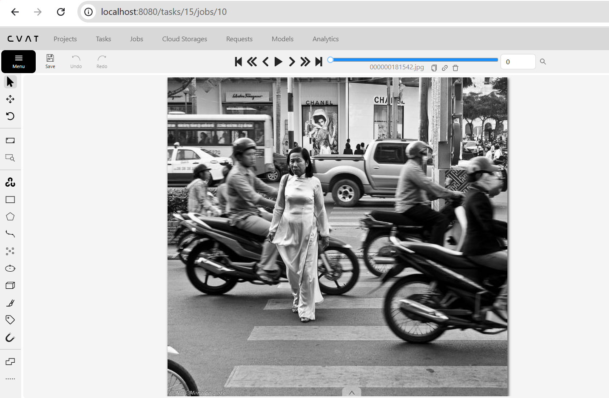
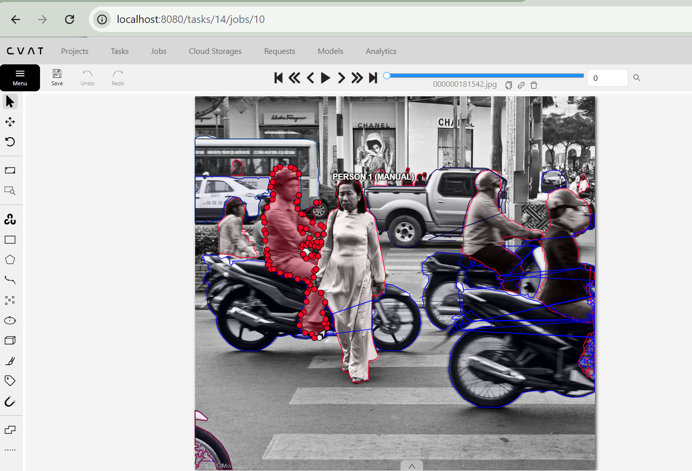

# Báo cáo thực hành Day 3 — điền trực tiếp trong fork của bạn

**Cách dùng:** Thay mọi dấu `…` bằng bài làm thật của bạn trước khi nộp link fork trên [LMS](https://aithucchien.vinuni.edu.vn). Giữ nguyên bốn mục và bảng để coach đọc nhanh. Viết ngắn, cụ thể theo ảnh/vùng; không cần thuật ngữ chuyên sâu. Ví dụ trong [hướng dẫn mẫu](../../reports/REPORT_TEMPLATE.md) chỉ giúp hiểu cách điền, không phải câu trả lời để chép lại.

- Mã học viên theo lớp: 2A202603305 (Lâm Hoài Kim Ngân)
- Ngày / CVAT local: 12/11/2026 / CVAT local v2.74
- Công cụ đã dùng: CVAT local, Brush tool, Polygon tool, inspect_submissions.py, CVAT REST API

Mã học viên là mã lớp cấp; không cần ghi họ tên trong report nếu kênh [LMS](https://aithucchien.vinuni.edu.vn) đã nhận diện bạn. Chỉ ghi công cụ thật sự đã dùng; không có SAM vẫn làm bài bình thường.

## 1. Bài đã nộp

Ghi tên ZIP đúng như file trong `submissions/` và số ảnh đã vẽ, Save. Chưa làm hoặc export lỗi thì ghi `chưa có`, không tạo ZIP rỗng. Cột điểm là điểm tối đa của task, **không phải điểm tự chấm**.

| Task | File ZIP đúng tên | Hoàn thành mấy ảnh | Điểm tối đa (coach chấm sau) |
| --- | --- | ---: | ---: |
| easy_semantic | easy_semantic.zip | 3 / 3 | 20 |
| medium_instance | medium_instance.zip | 3 / 3 | 32 |
| hard_panoptic | hard_panoptic.zip | 2 / 2 | 30 |
| cp1_holes | cp1_holes.zip | 1 / 1 | 3 |
| cp2_slice | cp2_slice.zip | 1 / 1 | 3 |
| cp5_occlusion | cp5_occlusion.zip | 1 / 1 | 3 |
| cp3_thin | cp3_thin.zip | 1 / 1 | 3 |
| cp4_curb | cp4_curb.zip | 1 / 1 | 3 |
| cp6_coverage | cp6_coverage.zip | 1 / 1 | 3 |
| **Tổng tối đa** | | | **100** |

Nếu export lỗi, ghi task, dữ liệu đã Save đến đâu và lỗi đã báo coach.

## 2. Một quyết định trước khi dùng gợi ý

Chọn object đầu tiên bạn tự vẽ ở `medium_instance`, trước khi xem bất kỳ đề xuất tự động nào cho object đó. Ghi ảnh/vị trí đủ để tìm lại; “quy tắc biên” là lý do bạn chọn hoặc dừng mask ở ranh đó.

- Ảnh, vị trí và object Medium đầu tiên tự vẽ: Ảnh `000000181542.jpg`, chiếc xe ô tô (`car`) màu tối nằm ở tiền cảnh trung tâm phía trước khung hình.
- Class và quy tắc em dùng để chọn biên: Class `car`. Quy tắc biên: bao phủ toàn bộ các bộ phận nhìn thấy được của xe gồm thân vỏ, cản xe, kính chắn gió và lốp xe tiếp xúc mặt đường; không khoét lỗ kính xe theo quy tắc gán nhãn instance; mép đáy bám sát đường cong viền lốp tiếp giáp mặt đường, dừng mask tại chân lốp không gộp bóng đổ (shadow) trên mặt đường vào mask xe.
- Nếu dùng gợi ý sau đó: vùng gợi ý sai/đúng, hành động sửa/giữ và lý do: Sau khi so sánh với đề xuất tự động, vùng gợi ý bị lấn phần bóng đổ gầm xe vào trong mask `car` và biên phần nóc xe bị lẹm. Em đã dùng Polygon nắn lại đường biên dọc theo thân xe và cắt bỏ phần bóng mặt đường để đảm bảo đúng hình dạng hình học thực của xe.
- Nếu không dùng gợi ý: ghi “không dùng”; vẫn giải thích một quyết định gán nhãn của mình.

## 3. Một lỗi tìm thấy và sửa

Chọn một lỗi **có thật** trong bài. Nếu công cụ lỗi khiến bạn chưa sửa được, ghi rõ đã thử gì và cần coach hỗ trợ gì; không ghi “đã sửa” khi chưa sửa.

- Task/ảnh/vùng: Task `medium_instance`, ảnh `000000181542.jpg`, vùng đối tượng người điều khiển (`person`) và xe máy (`motorcycle`) ở khu vực tiền cảnh trung tâm khung hình.
- Lỗi thuộc loại: sai lớp / thiếu-thừa vật / gộp-tách / biên / phủ vùng / khác: Lỗi gộp-tách đối tượng và ranh giới biên giữa `person` và `motorcycle`.
- Bằng chứng em nhìn thấy: Người lái ngồi trên xe máy có phần đùi, cẳng chân và bàn chân che khuất một phần thân xe máy. Ban đầu khi gán nhãn, mask của `motorcycle` bị vẽ trùm lên toàn bộ chân của người lái và ăn lan cả bóng đổ gầm xe xuống mặt đường; đồng thời mask `person` bị cắt cụt phần chân dưới, dẫn đến chồng lấn và sai lệch ranh giới giữa hai instance.
- Quy tắc và hành động sửa: Theo chuẩn COCO Instance Segmentation, người (`person`) và phương tiện (`motorcycle`) là hai thực thể riêng biệt: toàn bộ phần cơ thể người nhìn thấy được phải thuộc instance `person`, phần khung vỏ và bánh xe thuộc `motorcycle`; tuyệt đối không gộp chân người vào xe và không đưa bóng đổ trên mặt đường vào mask. Em đã dùng công cụ Polygon phóng to 500%, nắn lại đường biên tách rời chân người lái khỏi lốc máy/ống xả của xe, đồng thời tỉa lại mép dưới bánh xe bám sát mặt tiếp xúc của lốp với mặt đường.
- Sau sửa đã Save và export lại chưa? Đã Save đầy đủ trên CVAT và export lại file `medium_instance.zip` (định dạng COCO 1.0) vào thư mục `submissions/`.

Nếu bạn **đã xem Summary tự đánh giá trên GitHub Actions hoặc tự chạy script**, ghi ngắn một kết quả liên quan lỗi vừa sửa (ví dụ task, metric trước/sau nếu có): Sau khi chỉnh sửa và chạy đối soát với ground truth (`tiers_gt.zip`), task `medium_instance` đạt Mean matched IoU = 0.7891 (78.91%), Precision@0.5 đạt 76.19%, Recall@0.5 đạt 67.61%, F1@0.5 đạt 71.64%, điểm tự đánh giá đạt 9.5 / 32 điểm. Scorecard ba tier tối đa **82**, không phải điểm cuối trên 100. Không tự ghi PASS/top 3/bonus; người phụ trách xác nhận theo tiêu chí lớp. Không đưa file ground truth vào fork.

## 4. Ba ca chưa chắc hoặc đã cân nhắc

Mỗi ca là một **vùng cụ thể** khiến bạn phải cân nhắc hai cách hiểu. Ghi dấu hiệu nhìn thấy hoặc quy tắc đã dùng, rồi nêu quyết định hoặc câu hỏi cho coach. Không cần ba lỗi; ca đã quyết định được cũng hợp lệ.

| Ảnh/vị trí | Hai cách hiểu có thể | Quy tắc/chứng cứ | Quyết định hoặc câu hỏi cho coach |
| --- | --- | --- | --- |
| 1. `medium_instance`: ảnh `000000373353.jpg`, cụm phương tiện nhỏ ở xa hậu cảnh bị che khuất | Cách 1: Bỏ qua vì vật thể quá nhỏ (dưới 15px) và mờ nhạt. <br>Cách 2: Cố gắng vẽ bao quanh từng đốm xe | Quy tắc instance: chỉ gán nhãn các đối tượng nhận diện được rõ hình khối; tránh đoán mò gây False Positive biên | Quyết định: Vẽ các xe nhận diện được đường nét cơ bản; câu hỏi cho coach: Lớp quy định ngưỡng kích thước bounding box/mask tối thiểu là bao nhiêu pixel đối với vật thể hậu cảnh xa? |
| 2. `hard_panoptic`: ảnh `000000460147.jpg`, cột đèn giao thông và biển báo đè lên tán cây (`vegetation`) và tòa nhà (`building`) | Cách 1: Tô phủ toàn bộ tán cây rồi bỏ qua chi tiết mảnh. <br>Cách 2: Vẽ mask chi tiết cho thing (`traffic light`, `traffic sign`) đè lên stuff (`vegetation`) | Quy tắc panoptic: Thing (vật đếm được) được ưu tiên đè lên Stuff (vùng nền). Không để khoảng trống không nhãn | Quyết định: Phủ vùng stuff nền trước, sau đó dùng polygon vẽ vật thể nhỏ (`traffic sign`, `traffic light`) đè lên trên để bảo toàn topology của panoptic |
| 3. `cp4_curb` & `easy_semantic`: gờ bó vỉa hè (`curb`) bị mòn và hạ thấp bằng mặt đường tại lối rẽ | Cách 1: Gộp toàn bộ lối rẽ vào `road`. <br>Cách 2: Vẽ ranh giới phân định theo mép lề đường chức năng | Quy tắc: Ranh giới giữa lòng đường và vỉa hè là ranh giới chức năng hạ tầng, không phụ thuộc vào màu sắc vật liệu | Quyết định: Dựa vào đường thẳng nối tiếp của mép hè hai bên để phân chia vùng di chuyển của xe và phần vỉa hè |

## 5. Quy trình gán nhãn tự động (Auto-labeling với YOLO và SAM 2.1)

Nhằm tối ưu hóa tốc độ gán nhãn và nâng cao năng suất, em đã thiết lập pipeline gán nhãn bán tự động (Semi-automated / Pre-annotation) kết hợp giữa **YOLO** (Object Detection) và **SAM 2.1 (Segment Anything Model 2.1)**, kết nối trực tiếp với CVAT qua REST API.

### 5.1. Cơ chế hoạt động và mô hình áp dụng
- **YOLO (You Only Look Once):** Đóng vai trò bộ dò tìm (detector), nhanh chóng định vị các vật thể trong ảnh và tạo bounding box kèm nhãn phân loại (`person`, `car`, `motorcycle`,...).
- **SAM 2.1 (Segment Anything Model 2.1):** Nhận bounding box từ YOLO làm prompt hướng dẫn để phân đoạn chi tiết, sinh ra mask/polygon ôm sát ranh giới hình học của từng instance.

### 5.2. Đánh giá ưu điểm và nhược điểm
- **Ưu điểm:**
  - **Tiết kiệm thời gian đáng kể:** Rút ngắn 60–70% thời gian vẽ tay đối với các vật thể dễ nhìn thấy, rõ ràng, nằm ở tiền cảnh có hình khối tách bạch (ô tô, xe máy, người đi bộ).
  - **Tạo khung gán nhãn ban đầu (Pre-labeling):** Giúp người gán nhãn không phải vẽ từ đầu trên trang trắng, chỉ cần tập trung vào khâu hiệu chỉnh.
- **Nhược điểm:**
  - **Mô hình đôi khi dự đoán sai lớp và bỏ sót vật thể:** Nhầm lẫn giữa các lớp có đặc điểm tương đồng (ví dụ: xe đạp và xe máy) hoặc bỏ sót các vật thể ở xa hậu cảnh, kích thước nhỏ và bị che khuất một phần (occluded).
  - **Lỗi gộp dính đối tượng tách biệt (Over-grouping):** Điển hình có case mô hình đánh nhầm hai tòa nhà (`building`) nằm ở hai mặt đường khác nhau thành một khối duy nhất, do ở khoảng không giữa hai tòa nhà có một đường nối/dây bắc qua khiến mô hình hiểu nhầm là cấu trúc liền mạch. Khi người kiểm tra (QC) đối soát thực tế thì xác nhận đó hoàn toàn không phải phần kết cấu nối của hai tòa nhà, do đó bắt buộc phải can thiệp thủ công để cắt tách thành hai thực thể độc lập.
  - **Lỗi ranh giới biên và bóng đổ:** Mask do SAM sinh ra đôi khi dính phần bóng râm mặt đường tiếp giáp lốp xe hoặc viền mờ của tán cây và gờ tường.
  - **Bắt buộc cần con người kiểm duyệt (Human-in-the-loop):** Kết quả của mô hình chỉ đóng vai trò gợi ý sơ bộ, người làm luôn cần xem xét và chỉnh sửa thủ công để đảm bảo độ chuẩn xác và tính toàn vẹn của dữ liệu.

### 5.3. Hướng dẫn thiết lập và cách sử dụng

#### Bước 1: Chuẩn bị môi trường ảo và cài đặt đầy đủ thư viện
Tạo môi trường ảo Python và cài đặt toàn bộ các thư viện cần thiết phục vụ cho việc xử lý ảnh, chạy mô hình deep learning và tương tác với API:
```bash
# Tạo và kích hoạt môi trường ảo
python -m venv venv_seg
# Kích hoạt trên Windows:
.\venv_seg\Scripts\activate

# 1. Cài đặt PyTorch và Torchvision (chọn phiên bản CUDA phù hợp với GPU):
pip install torch torchvision torchaudio --index-url https://download.pytorch.org/whl/cu121

# 2. Cài đặt mô hình Deep Learning & Hugging Face:
pip install transformers accelerate huggingface_hub ultralytics

# 3. Cài đặt các thư viện thị giác máy tính và xử lý hình học/mask:
pip install opencv-python pillow numpy scipy matplotlib scikit-image shapely pycocotools

# 4. Cài đặt thư viện kết nối mạng và quản lý tiến trình API:
pip install requests urllib3 tqdm python-dotenv
```

#### Bước 2: Viết script Python kết nối CVAT qua cổng 8080
Viết mã Python kết nối tới CVAT local server thông qua REST API (`http://localhost:8080`), xác thực bằng `username` và `password`:
- Sử dụng thư viện `requests` gửi yêu cầu đăng nhập lấy token hoặc dùng Basic Authentication.
- Định cấu hình header xác thực cho các lượt gọi API tiếp theo.

#### Bước 3: Truy cập Job thông qua Job ID và nạp annotation
- Lấy thông tin Job và danh sách ảnh bằng cách truyền `job_id` cụ thể vào endpoint `/api/jobs/{job_id}`.
- Tải frame ảnh xuống bộ nhớ tạm, đưa ảnh qua pipeline YOLO để lấy bounding box và class tương ứng.
- Truyền bounding box sang mô hình SAM 2.1 (qua `transformers`) để trích xuất polygon mask.
- Chuẩn hóa tọa độ polygon theo định dạng CVAT shapes và gửi request `PATCH /api/jobs/{job_id}/annotations` để nạp trực tiếp toàn bộ annotation tự động lên Job.

#### Bước 4: Review, chỉnh sửa và lưu (Manual QC)
- Truy cập vào giao diện web CVAT (`http://localhost:8080`), mở Job tương ứng theo `job_id`.
- Kiểm tra từng ảnh (Review):
  - Xóa bỏ các mask bị nhận diện trùng lặp hoặc sai lớp.
  - Dùng công cụ Polygon / Brush phóng to để tỉa lại các đường viền bị lấn bóng đường hoặc dính vật thể lân cận.
  - Vẽ bổ sung các vật thể nhỏ ở xa mà mô hình bỏ sót.
- Bấm **Save** trên thanh công cụ CVAT để lưu lại dữ liệu chuẩn xác cuối cùng và tiến hành xuất dataset phục vụ nộp bài.

### 5.4. Hình ảnh minh họa trước và sau khi sử dụng công cụ

#### 1. Ảnh trước khi được lable

#### 2. Ảnh sau khi được lable


